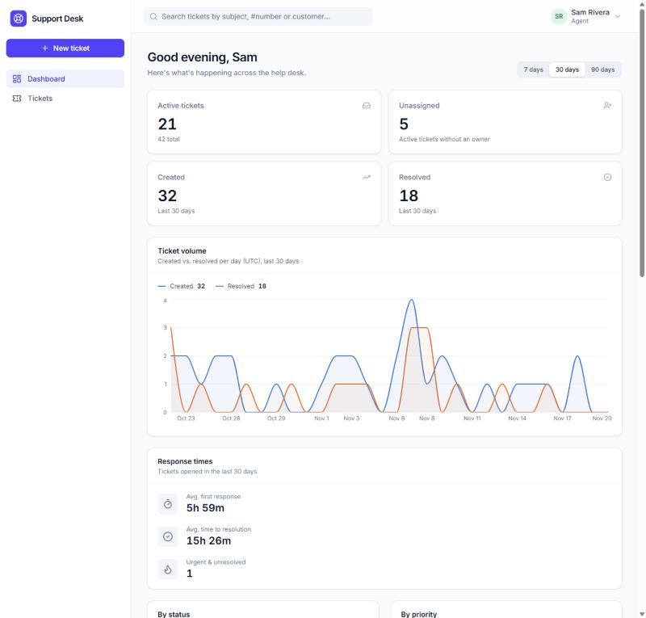
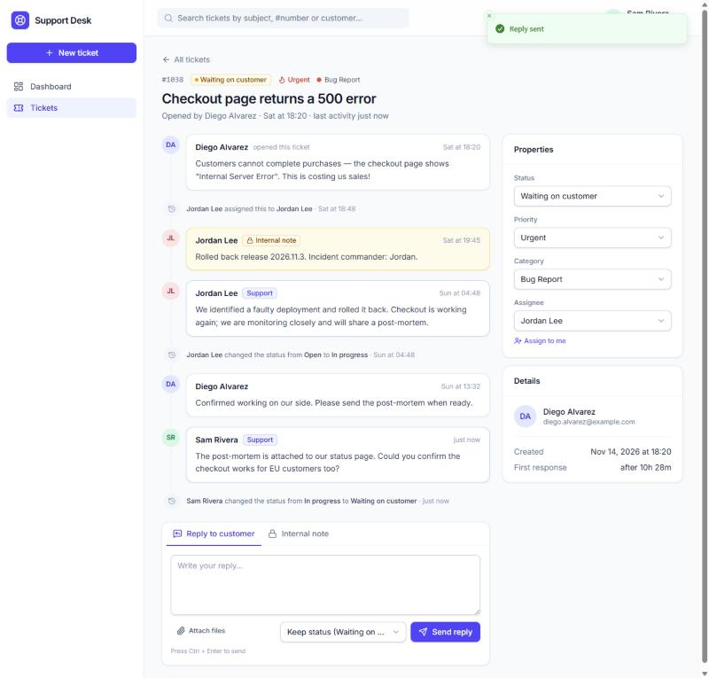

# Support Desk

A full-stack customer support ticketing system built with **React, TypeScript, Tailwind CSS, Fastify, Prisma and MongoDB**.

Customers open tickets and follow the conversation; agents triage, assign and resolve them, collaborating through internal notes; admins manage users and categories and watch the numbers on a live dashboard. Everything runs against a real MongoDB database — there is no mock data anywhere in the app.



| Agent view of a ticket                                       | Customer view with attachments                                    |
| ------------------------------------------------------------ | ----------------------------------------------------------------- |
|  |  |

---

## Contents

- [Features](#features)
- [Tech stack](#tech-stack)
- [Architecture](#architecture)
- [Getting started](#getting-started)
- [Environment variables](#environment-variables)
- [Scripts](#scripts)
- [Roles & permissions](#roles--permissions)
- [API reference](#api-reference)
- [Security](#security)
- [Testing](#testing)
- [Deployment](#deployment)
- [Troubleshooting](#troubleshooting)
- [Roadmap](#roadmap)

## Features

**Tickets**

- Create tickets with subject, description, priority (Low → Urgent), category and file attachments
- Human-friendly sequential numbers (`#1042`) generated atomically in MongoDB
- Status workflow: _Open → In progress → Waiting on customer → Resolved → Closed_, with timestamps kept in sync (`resolvedAt`, `closedAt`, `firstResponseAt`)
- Assignment to agents/admins, with "Assign to me" and automatic unassignment when an agent is deactivated
- Full activity history (status, priority, category, assignee and subject changes) interleaved with the conversation

**Conversation**

- Threaded replies with attachments, rendered as a timeline together with the ticket history
- **Internal notes** visible only to staff — including their attachments, which customers cannot download even with a direct link
- Staff can reply and change the status in one action (e.g. _Send & set to Waiting on customer_)
- A customer reply to a ticket that was waiting on them (or resolved) automatically reopens it
- Closed tickets are read-only until reopened

**Search, filtering & sorting**

- Full-text search over subject, description, ticket number (`#1042`) and — for staff — customer name/email
- Filter by status (incl. "all active"), priority, category and assignee (me / unassigned / any agent)
- Sort by last activity, newest, oldest or priority; paginated; all filters live in the URL so views can be shared

**Dashboard & statistics**

- Organisation-wide numbers for staff, personal numbers for customers
- Active, unassigned, urgent, created and resolved counts for 7/30/90-day periods
- Created vs. resolved trend chart (MongoDB aggregation pipeline), breakdowns by status, priority and category
- Average first-response and resolution times, team workload table, and the agent's own queue

**Administration**

- User management: create accounts, change roles, reset passwords, activate/deactivate (with safeguards against locking yourself out)
- Category management with colours; categories in use can be deactivated but not deleted, so reports stay accurate

**Quality of life**

- Responsive layout from phone to desktop, accessible forms and dialogs, keyboard shortcut (Ctrl + Enter) to send
- Image attachments previewed inline; drag-and-drop uploads with client-side checks mirroring the server's limits
- Cache-aware data fetching with TanStack Query (mutations update the cache in place); open tickets refresh automatically

## Tech stack

| Layer          | Technology                                                                                    |
| -------------- | --------------------------------------------------------------------------------------------- |
| Frontend       | React 19, TypeScript, Vite 7, Tailwind CSS 4, React Router 7, TanStack Query 5                |
| Forms & charts | React Hook Form + Zod resolvers, Recharts, Lucide icons, Sonner toasts                        |
| Backend        | Fastify 5, TypeScript, Zod validation, `@fastify/jwt`, helmet, CORS, rate limiting, multipart |
| Database       | MongoDB (replica set) via Prisma ORM 6                                                        |
| Shared         | `@support-desk/shared` — one source of truth for enums, permissions, Zod schemas and API DTOs |
| Tooling        | npm workspaces, Vitest + mongodb-memory-server, ESLint, Prettier, tsup, GitHub Actions        |

> **Why Prisma 6?** Prisma 7+ reworked its engine and does not yet offer the same MongoDB support, so this project pins the latest Prisma 6 release, which fully supports MongoDB.

## Architecture

```
.
├── apps/
│   ├── server/                 Fastify REST API
│   │   ├── prisma/             schema.prisma + seed script
│   │   ├── scripts/            local-db.ts (zero-install MongoDB replica set)
│   │   ├── src/
│   │   │   ├── config/         environment parsing & validation (Zod)
│   │   │   ├── lib/            errors, validation, password hashing, tokens, multipart, search
│   │   │   ├── plugins/        auth (JWT + permission guards), error handler
│   │   │   ├── modules/        feature modules: auth, users, categories, tickets, attachments, stats, system
│   │   │   │   └── <module>/   *.routes.ts (HTTP)  →  *.service.ts (business rules)  →  Prisma
│   │   │   ├── storage/        FileStorage interface + local-disk implementation
│   │   │   ├── serializers.ts  Prisma rows → API DTOs (never leaks internal fields)
│   │   │   ├── services.ts     composition root (dependency injection)
│   │   │   └── app.ts          buildApp(): plugins, routes, static web hosting
│   │   └── test/               integration tests against a real in-memory replica set
│   └── web/                    React SPA
│       └── src/
│           ├── api/            fetch client (token refresh), typed endpoints, query hooks
│           ├── auth/           AuthProvider, route guards
│           ├── components/     ui/ (Button, Input, Modal, …) and layout/
│           ├── features/       tickets, dashboard, auth building blocks
│           └── pages/          route-level pages (code-split)
└── packages/
    └── shared/                 constants, permissions, Zod schemas, DTO types
```

Key design decisions:

- **One validation source.** Request schemas live in `packages/shared` and are used by Fastify (to reject bad input with field-level errors) _and_ by React Hook Form (to show the same messages before submitting).
- **Thin routes, rich services.** Routes parse input and shape responses; services hold the business rules (status transitions, who may see what) and are wired once in `services.ts`, which keeps them easy to test.
- **Authorization in one place.** `ROLE_PERMISSIONS` maps roles to permissions; the API enforces them with `app.authorize(...)` and ticket-level policies (`canViewTicket`, `canSeeInternal`), and the UI uses the same functions to decide what to show.
- **Storage abstraction.** Attachments go through a `FileStorage` interface; the local-disk driver can be swapped for S3/GCS without touching the ticket logic.
- **Real MongoDB features.** Atomic `findAndModify` counters for ticket numbers, aggregation pipelines for statistics, a TTL index that expires refresh tokens, and compound indexes for every list query.

## Getting started

### Prerequisites

- **Node.js 22.12+** (npm 10+)
- **MongoDB running as a replica set** — Prisma needs one for transactions. Pick any option:
  1. **No install:** `npm run db:local` downloads an official MongoDB binary on first run and starts a persistent single-node replica set on `127.0.0.1:27017` (data in `apps/server/.mongo-data/`).
  2. **Docker:** `docker compose up -d` starts MongoDB 7 with the replica set initialised.
  3. **MongoDB Atlas:** a free cluster works out of the box — paste its connection string into `DATABASE_URL`.

### Quick start

```bash
git clone <your-fork-url> support-desk
cd support-desk
npm install          # installs all workspaces and generates the Prisma client
npm run setup        # creates apps/server/.env (with a random JWT secret) and apps/web/.env
```

In a separate terminal, start MongoDB (skip if you use Docker or Atlas):

```bash
npm run db:local
```

Then create the collections/indexes, load demo data and start the app:

```bash
npm run db:push      # sync the Prisma schema (collections + indexes)
npm run db:seed      # demo users, categories and ~40 tickets
npm run dev          # API on http://localhost:4000, web app on http://localhost:5173
```

Open **http://localhost:5173** and sign in with one of the demo accounts (the sign-in page has one-click buttons for them in development):

| Role     | Email                  | Password       |
| -------- | ---------------------- | -------------- |
| Admin    | `admin@example.com`    | `Admin123!`    |
| Agent    | `agent@example.com`    | `Agent123!`    |
| Customer | `customer@example.com` | `Customer123!` |

Further agents and customers are listed in [`apps/server/prisma/seed.ts`](apps/server/prisma/seed.ts). Run `npm run db:reset` at any time to wipe the database and reseed it.

## Environment variables

The API reads `apps/server/.env` (see [`apps/server/.env.example`](apps/server/.env.example)); every value is validated at startup and the server refuses to start with a clear message if something is wrong.

| Variable                   | Default                 | Description                                                            |
| -------------------------- | ----------------------- | ---------------------------------------------------------------------- |
| `DATABASE_URL`             | —                       | MongoDB connection string (replica set required)                       |
| `JWT_ACCESS_SECRET`        | —                       | Secret for signing access tokens, **at least 32 characters**           |
| `ACCESS_TOKEN_TTL_MINUTES` | `15`                    | Access-token lifetime                                                  |
| `REFRESH_TOKEN_TTL_DAYS`   | `7`                     | Refresh-token (session) lifetime                                       |
| `PORT` / `HOST`            | `4000` / `0.0.0.0`      | Where the API listens                                                  |
| `CORS_ORIGIN`              | `http://localhost:5173` | Comma-separated origins allowed to call the API with credentials       |
| `COOKIE_SECURE`            | `true` in production    | Send the session cookie over HTTPS only                                |
| `COOKIE_SAME_SITE`         | `strict`                | Use `none` (with HTTPS) only if the web app is on a different site     |
| `TRUST_PROXY`              | `false`                 | Set behind a reverse proxy so client IPs/rate limits are correct       |
| `ALLOW_REGISTRATION`       | `true`                  | Allow visitors to create customer accounts                             |
| `UPLOAD_DIR`               | `./uploads`             | Attachment storage directory                                           |
| `MAX_UPLOAD_SIZE_MB`       | `10`                    | Per-file size limit                                                    |
| `MAX_FILES_PER_UPLOAD`     | `5`                     | Files per ticket/reply                                                 |
| `RATE_LIMIT_MAX`           | `300`                   | Requests per minute per IP                                             |
| `AUTH_RATE_LIMIT_MAX`      | `10`                    | Sign-in/registration attempts per minute per IP                        |
| `SERVE_WEB`                | `false`                 | Serve the built React app from the API (single-port production deploy) |
| `LOG_LEVEL`                | `info`                  | Pino log level                                                         |

The web app reads `apps/web/.env`: `VITE_API_URL` (default `/api`), `VITE_SHOW_DEMO_ACCOUNTS` (show demo logins in production builds) and the dev-proxy settings `API_PROXY_TARGET` / `WEB_PORT`.

## Scripts

Run from the repository root:

| Command                              | What it does                                               |
| ------------------------------------ | ---------------------------------------------------------- |
| `npm run setup`                      | Create `.env` files from the examples (never overwrites)   |
| `npm run dev`                        | Start API (watch mode) and web app (Vite) together         |
| `npm run build`                      | Production build of the API (`tsup`) and web app (`vite`)  |
| `npm start`                          | Start the built API (set `SERVE_WEB=true` to host the SPA) |
| `npm test`                           | Run the API integration tests                              |
| `npm run lint` / `npm run typecheck` | ESLint / TypeScript across all workspaces                  |
| `npm run format`                     | Prettier                                                   |
| `npm run db:local`                   | Zero-install local MongoDB replica set                     |
| `npm run db:push`                    | Sync collections and indexes with `schema.prisma`          |
| `npm run db:seed` / `db:reset`       | Seed demo data / wipe and reseed                           |
| `npm run db:studio`                  | Browse the data in Prisma Studio                           |

## Roles & permissions

| Capability                                      | Customer | Agent | Admin |
| ----------------------------------------------- | :------: | :---: | :---: |
| Create tickets, reply, attach files             |    ✅    |  ✅   |  ✅   |
| See tickets                                     |   own    |  all  |  all  |
| Close / reopen own tickets                      |    ✅    |  ✅   |  ✅   |
| Change status, priority, category of any ticket |          |  ✅   |  ✅   |
| Assign tickets                                  |          |  ✅   |  ✅   |
| Read & write internal notes                     |          |  ✅   |  ✅   |
| Organisation-wide statistics                    |          |  ✅   |  ✅   |
| Delete tickets                                  |          |       |  ✅   |
| Manage users and categories                     |          |       |  ✅   |

Permissions are defined once in [`packages/shared/src/permissions.ts`](packages/shared/src/permissions.ts). Tickets a user may not see return **404** rather than 403, so ticket ids cannot be probed.

## API reference

All endpoints are under `/api`. Authenticated requests send `Authorization: Bearer <accessToken>`. Errors always have the shape `{ "error": { "code", "message", "details?" } }`, where `details` lists field-level validation issues.

| Method & path                        | Auth   | Description                                                                   |
| ------------------------------------ | ------ | ----------------------------------------------------------------------------- |
| `GET /health`                        | —      | Liveness + database check                                                     |
| `GET /config`                        | —      | Public settings (registration enabled, upload limits)                         |
| `POST /auth/register`                | —      | Create a customer account and start a session                                 |
| `POST /auth/login`                   | —      | Start a session; returns `{ user, accessToken }` and sets the refresh cookie  |
| `POST /auth/refresh`                 | cookie | Rotate the refresh token and return a new access token                        |
| `POST /auth/logout`                  | cookie | Revoke the session                                                            |
| `GET/PATCH /auth/me`                 | user   | Read / update own profile                                                     |
| `POST /auth/change-password`         | user   | Change password (signs out other sessions)                                    |
| `GET /tickets`                       | user   | List with `q, status, priority, categoryId, assigneeId, sort, page, pageSize` |
| `POST /tickets`                      | user   | Create (JSON or `multipart/form-data` with `files`)                           |
| `GET /tickets/:id`                   | user   | Ticket with conversation, attachments and history                             |
| `PATCH /tickets/:id`                 | user   | Update status / priority / category / assignee / subject (permission-checked) |
| `DELETE /tickets/:id`                | admin  | Delete ticket, conversation and files                                         |
| `POST /tickets/:id/messages`         | user   | Reply or internal note (`isInternal`), optional `status`, optional `files`    |
| `GET /attachments/:id/download`      | user   | Download an attachment you are allowed to see                                 |
| `GET /stats/overview?days=30`        | user   | Dashboard statistics (organisation for staff, personal for customers)         |
| `GET /categories`                    | user   | Categories (`?includeInactive=true` for admins)                               |
| `POST/PATCH/DELETE /categories/:id?` | admin  | Manage categories                                                             |
| `GET /users`                         | admin  | List users with `q, role, status, page`                                       |
| `GET /users/assignable`              | staff  | Active agents/admins for the assignee picker                                  |
| `POST /users`, `PATCH /users/:id`    | admin  | Create users, change role, reset password, (de)activate                       |

## Security

- **Passwords** hashed with Node's built-in **scrypt** (OWASP parameters, per-user salt, constant-time comparison); parameters are stored with each hash so they can be raised later.
- **Sessions:** short-lived JWT access tokens kept in memory (never in `localStorage`) plus an opaque refresh token in an **httpOnly, SameSite=Strict** cookie scoped to `/api/auth`. Refresh tokens are stored as SHA-256 hashes, **rotated on every use**, and **replaying an old token revokes the whole session** (reuse detection). Expired tokens are purged by a MongoDB TTL index.
- **Immediate revocation:** each request re-checks that the account is still active, so deactivating a user or changing their role takes effect at once.
- **No account enumeration:** unknown emails and wrong passwords return the same response in the same time.
- **Validation everywhere:** every body, query and route parameter is validated with Zod; search input is regex-escaped before reaching MongoDB.
- **Uploads:** streamed to disk (never buffered in memory), limited by size and count, allowed by extension with the MIME type derived server-side, stored under random names outside the web root, and always served as downloads with `X-Content-Type-Options: nosniff`. Files are cleaned up if the request fails.
- **HTTP hardening:** Helmet (CSP, HSTS behind HTTPS, frame protection), strict CORS allow-list, global and per-route rate limits, 1 MB JSON body limit, and generic 500 responses that never leak stack traces. Authorization headers and cookies are redacted from logs.

## Testing

```bash
npm test
```

The API is covered by **46 integration tests** that start a real MongoDB replica set in memory (via `mongodb-memory-server`), push the Prisma schema, and exercise the app through `fastify.inject()` — no mocks. They cover registration and login, refresh-token rotation and reuse detection, role-based access, internal-note privacy (including attachment downloads), status transitions and timestamps, assignment rules, search/filter/sort/pagination, upload limits and cleanup, statistics, and admin safeguards. The first run downloads a MongoDB binary (cached afterwards).

CI ([`.github/workflows/ci.yml`](.github/workflows/ci.yml)) runs formatting, linting, type-checking, tests and the production build on every push and pull request.

## Deployment

### Single Node.js process

```bash
npm ci
npm run build
# apps/server/.env: NODE_ENV=production, SERVE_WEB=true, COOKIE_SECURE=true, a strong JWT_ACCESS_SECRET, ...
npm run db:push
npm start            # serves the API and the React app on PORT (default 4000)
```

Put it behind an HTTPS reverse proxy (and set `TRUST_PROXY=true`). Attachments are written to `UPLOAD_DIR`, so mount persistent storage there.

### Docker

The repository includes a multi-stage [`Dockerfile`](Dockerfile) and a `docker-compose.yml` profile that runs the app next to MongoDB:

```bash
JWT_ACCESS_SECRET=$(node -e "console.log(require('crypto').randomBytes(48).toString('base64url'))") \
  docker compose --profile app up -d --build
# then, once: seed demo data from your machine
DATABASE_URL="mongodb://127.0.0.1:27017/support_desk?directConnection=true" npm run db:seed
```

The container syncs indexes on start, runs as a non-root user and exposes a health check.

### Separate hosting

The web app can also be deployed to any static host: build it with `VITE_API_URL=https://api.example.com/api`, add that origin to `CORS_ORIGIN`, and set `COOKIE_SAME_SITE=none` + `COOKIE_SECURE=true` on the API so the session cookie works across sites.

## Troubleshooting

| Problem                                                                                               | Fix                                                                                                                                       |
| ----------------------------------------------------------------------------------------------------- | ----------------------------------------------------------------------------------------------------------------------------------------- |
| `Prisma needs to perform transactions, which requires your MongoDB server to be run as a replica set` | Use `npm run db:local`, `docker compose up -d`, or Atlas — a standalone `mongod` is not enough.                                           |
| `Invalid environment configuration` on startup                                                        | Run `npm run setup`, or check `apps/server/.env` against `.env.example` (the message names the bad variable).                             |
| `EPERM … query_engine-windows.dll.node` during `npm install` (Windows)                                | Stop the running API (`npm run dev`) first — it holds the Prisma engine file open.                                                        |
| Port `27017`, `4000` or `5173` already in use                                                         | Stop the other process, or change `LOCAL_MONGO_PORT`, `PORT` or `WEB_PORT`.                                                               |
| Signed out after every reload                                                                         | The refresh cookie was rejected: on plain HTTP keep `COOKIE_SECURE=false`; across different sites use `COOKIE_SAME_SITE=none` over HTTPS. |

## Roadmap

- Email notifications for new replies and assignment changes
- Real-time updates over WebSockets instead of polling
- S3-compatible attachment storage driver
- SLA policies with due dates and breach alerts
- Canned responses and saved views for agents
- Dark mode
