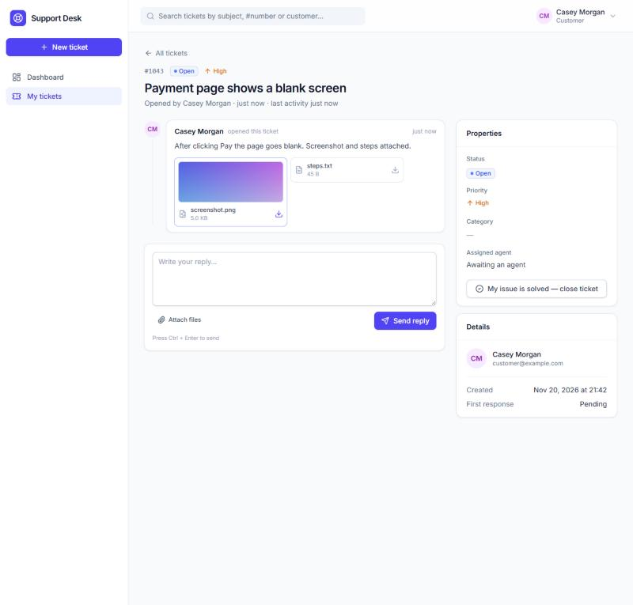

# Support Desk

A full-stack customer support ticketing system built with **React, TypeScript, Tailwind CSS, Fastify, Prisma and MongoDB**.

It's multi-tenant: anyone can create a **company**, which gets its own branded ticket page (e.g. `/acme`), accounts, categories and tickets. Customers — signed in, as email-confirmed guests, or anonymously — open tickets and follow the conversation; agents triage, assign and resolve them, collaborating through internal notes; the company's manager runs the team and watches the numbers on a live dashboard. Everything runs against a real MongoDB database — there is no mock data anywhere in the app.


| Agent view of a ticket                                       | Customer view with attachments                                    |
| ------------------------------------------------------------ | ----------------------------------------------------------------- |
|  |  |

---

## Contents

- [Features](#features)
- [Tech stack](#tech-stack)
- [Architecture](#architecture)
- [Getting started](#getting-started)
- [Environment variables](#environment-variables)
- [Scripts](#scripts)
- [Roles & permissions](#roles--permissions)
- [API reference](#api-reference)
- [Security](#security)
- [Testing](#testing)
- [Deployment](#deployment)
- [Troubleshooting](#troubleshooting)
- [Roadmap](#roadmap)

## Features

**Companies & accounts**

- Self-service company sign-up: pick a name and address (`/acme`, checked live for availability) and become the company's **owner**
- **Accounts belong to a company.** The same email can have separate accounts (and passwords) at different companies — e.g. an agent at Acme and a customer at Globex — but only one account per company
- A browser can stay signed in to several companies at once (one session cookie per company)
- **Find my company:** forgot your company's address? Enter your email at `/find` and get a list of every company where you have an account, with a sign-in link for each — sent by email only, so the page never reveals who has an account
- **Email confirmation** for every new account, **forgot / reset password** by email, and resend links with a cooldown
- Real email over SMTP in production; in development, emails land in a built-in **dev mailbox** (`/dev/mailbox`) so every flow works without an email provider
- Strict tenant isolation: tickets, users, categories, statistics and files never cross company boundaries

**Public ticket page**

- Every company has a branded page at its address (`/acme`) with its own headline, welcome message and brand colour (text colour picked automatically for contrast)
- The company chooses who may open requests: **registered customers**, **guests** and/or **anonymous** submitters
- **Guests** enter their name and email; the request reaches the team only after they click the confirmation link (unconfirmed requests and their files are deleted after 24 hours). Confirming signs them in to a password-less guest account, where they can follow the ticket and later set a password
- **Anonymous requests** still need a confirmed email so the requester can follow up, but the team only ever sees "Anonymous" — the name and email are removed on the server, in every ticket, message, notification and search result
- Requesters get an email when the team replies, with a one-click sign-in link straight to the ticket; "Email me a sign-in link" works for anyone without a password
- Abuse controls: rate limits, a honeypot field, at most 5 unconfirmed requests per email and an optional **human check** ([Cloudflare Turnstile](https://www.cloudflare.com/products/turnstile/)) on every public form

**Tickets**

- Create tickets with subject, description, priority (Low → Urgent), category and file attachments
- Human-friendly sequential numbers (`#1042`), counted separately per company and generated atomically in MongoDB
- Status workflow: _Open → In progress → Waiting on customer → Resolved → Closed_, with timestamps kept in sync (`resolvedAt`, `closedAt`, `firstResponseAt`)
- Assignment to agents/admins, with "Assign to me" and automatic unassignment when an agent is deactivated
- Full activity history (status, priority, category, assignee and subject changes) interleaved with the conversation

**Conversation**

- Threaded replies with attachments, rendered as a timeline together with the ticket history
- **Internal notes** visible only to staff — including their attachments, which customers cannot download even with a direct link
- Staff can reply and change the status in one action (e.g. _Send & set to Waiting on customer_)
- A customer reply to a ticket that was waiting on them (or resolved) automatically reopens it
- Closed tickets are read-only until reopened

**Search, filtering & sorting**

- Full-text search over subject, description, ticket number (`#1042`) and — for staff — customer name/email
- Filter by status (incl. "all active"), priority, category and assignee (me / unassigned / any agent)
- Sort by last activity, newest, oldest or priority; paginated; all filters live in the URL so views can be shared

**Dashboard & statistics**

- Organisation-wide numbers for staff, personal numbers for customers
- Active, unassigned, urgent, created and resolved counts for 7/30/90-day periods
- Created vs. resolved trend chart (MongoDB aggregation pipeline), breakdowns by status, priority and category
- Average first-response and resolution times, team workload table, and the agent's own queue

**Team & permissions**

- **Permission groups:** 16 fine-grained permissions (see all tickets, reply, internal notes, change status/priority, assign self/others, delete, manage customers, reports, team, groups, categories, company settings), bundled into groups. Every company starts with _Administrator_, _Agent_ and _Read-only_; edits apply to members immediately
- **Invitation-only team:** managers invite people by email and pick a group; the invitee accepts or declines from their own account (or signs up first — the invite waits for them). Resend, cancel, 14-day expiry, unlimited agents
- Change an agent's group or remove them from the team (they become a customer again and their open tickets return to the queue). The owner can never be changed or removed, and nobody can change their own access
- **Customers page** to find customers and deactivate/reactivate accounts
- **Notification bell** for invitations, assignments, replies and internal notes on your tickets
- Category management with colours (categories in use can be deactivated but not deleted, so reports stay accurate) and company settings

**Quality of life**

- Responsive layout from phone to desktop, accessible forms and dialogs, keyboard shortcut (Ctrl + Enter) to send
- Image attachments previewed inline; drag-and-drop uploads with client-side checks mirroring the server's limits
- Cache-aware data fetching with TanStack Query (mutations update the cache in place); open tickets refresh automatically

## Tech stack

| Layer          | Technology                                                                                    |
| -------------- | --------------------------------------------------------------------------------------------- |
| Frontend       | React 19, TypeScript, Vite 7, Tailwind CSS 4, React Router 7, TanStack Query 5                |
| Forms & charts | React Hook Form + Zod resolvers, Recharts, Lucide icons, Sonner toasts                        |
| Backend        | Fastify 5, TypeScript, Zod validation, `@fastify/jwt`, helmet, CORS, rate limiting, multipart |
| Database       | MongoDB (replica set) via Prisma ORM 6                                                        |
| Shared         | `@support-desk/shared` — one source of truth for enums, permissions, Zod schemas and API DTOs |
| Tooling        | npm workspaces, Vitest + mongodb-memory-server, ESLint, Prettier, tsup, GitHub Actions        |

> **Why Prisma 6?** Prisma 7+ reworked its engine and does not yet offer the same MongoDB support, so this project pins the latest Prisma 6 release, which fully supports MongoDB.

## Architecture

```
.
├── apps/
│   ├── server/                 Fastify REST API
│   │   ├── prisma/             schema.prisma + seed script
│   │   ├── scripts/            local-db.ts (zero-install MongoDB replica set)
│   │   ├── src/
│   │   │   ├── config/         environment parsing & validation (Zod)
│   │   │   ├── email/          Mailer interface (SMTP + dev mailbox) and email templates
│   │   │   ├── lib/            errors, validation, password hashing, tokens, multipart, search
│   │   │   ├── plugins/        auth (JWT + permission guards), captcha (human check), error handler
│   │   │   ├── modules/        auth, companies, portal, team, groups, customers, tickets, attachments,
│   │   │   │                   categories, notifications, stats, system, dev
│   │   │   │   └── <module>/   *.routes.ts (HTTP)  →  *.service.ts (business rules)  →  Prisma
│   │   │   ├── storage/        FileStorage interface + local-disk implementation
│   │   │   ├── serializers.ts  Prisma rows → API DTOs (never leaks internal fields)
│   │   │   ├── services.ts     composition root (dependency injection)
│   │   │   └── app.ts          buildApp(): plugins, routes, static web hosting
│   │   └── test/               integration tests against a real in-memory replica set
│   └── web/                    React SPA
│       └── src/
│           ├── api/            fetch client (token refresh), typed endpoints, query hooks
│           ├── auth/           AuthProvider (one session per company), route guards
│           ├── company/        CompanyRoot (/:slug routes), company context & path helper
│           ├── components/     ui/ (Button, Input, Modal, …) and layout/
│           ├── features/       tickets, portal, captcha, dashboard, auth building blocks
│           └── pages/          route-level pages (code-split)
└── packages/
    └── shared/                 constants, permissions, Zod schemas, DTO types
```

Key design decisions:

- **Tenant isolation by construction.** Every company-owned record carries a `companyId`; the access token names the company (`cid`) and the auth hook rejects tokens whose user belongs elsewhere; every service query is scoped by the signed-in user's company, and the integration tests check cross-company access explicitly.

- **One validation source.** Request schemas live in `packages/shared` and are used by Fastify (to reject bad input with field-level errors) _and_ by React Hook Form (to show the same messages before submitting).
- **Thin routes, rich services.** Routes parse input and shape responses; services hold the business rules (status transitions, who may see what) and are wired once in `services.ts`, which keeps them easy to test.
- **Authorization in one place.** Permissions are a shared catalogue; a user's effective permissions are computed from their role and permission group on every request (so edits apply instantly). The API enforces them with `app.authorize(...)` / `app.authorizeAny(...)` and ticket-level policies (`canViewTicket`, `canSeeInternal`), and the UI reads the same list to decide what to show.
- **Storage abstraction.** Attachments go through a `FileStorage` interface; the local-disk driver can be swapped for S3/GCS without touching the ticket logic.
- **Real MongoDB features.** Atomic per-company `findAndModify` counters for ticket numbers, aggregation pipelines for statistics, TTL indexes that expire sessions, email links and dev emails, and company-prefixed compound indexes for every list query.

## Getting started

### Prerequisites

- **Node.js 22.12+** (npm 10+)
- **MongoDB running as a replica set** — Prisma needs one for transactions. Pick any option:
  1. **No install:** `npm run db:local` downloads an official MongoDB binary on first run and starts a persistent single-node replica set on `127.0.0.1:27017` (data in `apps/server/.mongo-data/`).
  2. **Docker:** `docker compose up -d` starts MongoDB 7 with the replica set initialised.
  3. **MongoDB Atlas:** a free cluster works out of the box — paste its connection string into `DATABASE_URL`.

### Quick start

```bash
git clone <your-fork-url> support-desk
cd support-desk
npm install          # installs all workspaces and generates the Prisma client
npm run setup        # creates apps/server/.env (with a random JWT secret) and apps/web/.env
```

In a separate terminal, start MongoDB (skip if you use Docker or Atlas):

```bash
npm run db:local
```

Then create the collections/indexes, load demo data and start the app:

```bash
npm run db:push      # sync the Prisma schema (collections + indexes)
npm run db:seed      # two demo companies with users, categories and tickets
npm run dev          # API on http://localhost:4000, web app on http://localhost:5173
```

Open **http://localhost:5173**. From there you can create your own company, or open a demo company's ticket page: **http://localhost:5173/acme** (42 tickets; accepts account, guest and anonymous requests) or **http://localhost:5173/globex** (14 tickets; account holders only). Both companies have these accounts — separate accounts with the same emails, which shows how accounts are scoped per company (the sign-in page has one-click buttons for them in development):

| Role                  | Email                  | Password       |
| --------------------- | ---------------------- | -------------- |
| Owner                 | `admin@example.com`    | `Admin123!`    |
| Agent (_Agent_ group) | `agent@example.com`    | `Agent123!`    |
| Customer              | `customer@example.com` | `Customer123!` |

At Acme, `jordan.lee@example.com` / `Agent123!` is in the _Administrator_ group, and two invitations are pending — sign in as `priya.patel@example.com` / `Customer123!` to accept one. Further agents and customers are listed in [`apps/server/prisma/seed.ts`](apps/server/prisma/seed.ts). Run `npm run db:reset` at any time to wipe the database and reseed it.

Emails sent while developing (account and request confirmations, sign-in links, reply notifications, password resets, invitations) appear at **http://localhost:5173/dev/mailbox** — open them there and click the link. To try the guest flow, send a request from `/acme` while signed out and confirm it from the mailbox.

> **Upgrading from an earlier version?** Run `npm run db:push && npm run db:reset` once: the schema gained companies, permission groups and public-page settings, and older data can't be mapped onto them.

## Environment variables

The API reads `apps/server/.env` (see [`apps/server/.env.example`](apps/server/.env.example)); every value is validated at startup and the server refuses to start with a clear message if something is wrong.

| Variable                   | Default                               | Description                                                                        |
| -------------------------- | ------------------------------------- | ---------------------------------------------------------------------------------- |
| `DATABASE_URL`             | —                                     | MongoDB connection string (replica set required)                                   |
| `JWT_ACCESS_SECRET`        | —                                     | Secret for signing access tokens, **at least 32 characters**                       |
| `ACCESS_TOKEN_TTL_MINUTES` | `15`                                  | Access-token lifetime                                                              |
| `REFRESH_TOKEN_TTL_DAYS`   | `7`                                   | Refresh-token (session) lifetime                                                   |
| `PORT` / `HOST`            | `4000` / `0.0.0.0`                    | Where the API listens                                                              |
| `CORS_ORIGIN`              | `http://localhost:5173`               | Comma-separated origins allowed to call the API with credentials                   |
| `COOKIE_SECURE`            | `true` in production                  | Send the session cookie over HTTPS only                                            |
| `COOKIE_SAME_SITE`         | `strict`                              | Use `none` (with HTTPS) only if the web app is on a different site                 |
| `TRUST_PROXY`              | `false`                               | Set behind a reverse proxy so client IPs/rate limits are correct                   |
| `ALLOW_COMPANY_SIGNUP`     | `true`                                | Allow visitors to create new companies at `/signup`                                |
| `ALLOW_REGISTRATION`       | `true`                                | Allow visitors to register customer accounts (each company can also turn it off)   |
| `APP_URL`                  | `http://localhost:5173`               | Public URL of the web app, used for links in emails                                |
| `EMAIL_TRANSPORT`          | `dev` (`smtp` in production)          | `dev` stores emails for `/dev/mailbox`; `smtp` sends them (required in production) |
| `EMAIL_FROM`               | `Support Desk <no-reply@example.com>` | Sender address                                                                     |
| `SMTP_HOST` / `SMTP_PORT`  | — / `587`                             | SMTP server (Gmail, Resend, SendGrid, Postmark, SES, …)                            |
| `SMTP_SECURE`              | `true` for port 465                   | Use implicit TLS                                                                   |
| `SMTP_USER` / `SMTP_PASS`  | —                                     | SMTP credentials                                                                   |
| `UPLOAD_DIR`               | `./uploads`                           | Attachment storage directory                                                       |
| `MAX_UPLOAD_SIZE_MB`       | `10`                                  | Per-file size limit                                                                |
| `MAX_FILES_PER_UPLOAD`     | `5`                                   | Files per ticket/reply                                                             |
| `RATE_LIMIT_MAX`           | `300`                                 | Requests per minute per IP                                                         |
| `AUTH_RATE_LIMIT_MAX`      | `10`                                  | Sign-in/registration attempts per minute per IP                                    |
| `TURNSTILE_SITE_KEY`       | —                                     | Cloudflare Turnstile site key; set both keys to turn on the human check            |
| `TURNSTILE_SECRET_KEY`     | —                                     | Cloudflare Turnstile secret key (server-side verification)                         |
| `SERVE_WEB`                | `false`                               | Serve the built React app from the API (single-port production deploy)             |
| `LOG_LEVEL`                | `info`                                | Pino log level                                                                     |

The web app reads `apps/web/.env`: `VITE_API_URL` (default `/api`), `VITE_SHOW_DEMO_ACCOUNTS` (show demo logins in production builds) and the dev-proxy settings `API_PROXY_TARGET` / `WEB_PORT`.

## Scripts

Run from the repository root:

| Command                              | What it does                                               |
| ------------------------------------ | ---------------------------------------------------------- |
| `npm run setup`                      | Create `.env` files from the examples (never overwrites)   |
| `npm run dev`                        | Start API (watch mode) and web app (Vite) together         |
| `npm run build`                      | Production build of the API (`tsup`) and web app (`vite`)  |
| `npm start`                          | Start the built API (set `SERVE_WEB=true` to host the SPA) |
| `npm test`                           | Run the API integration tests                              |
| `npm run lint` / `npm run typecheck` | ESLint / TypeScript across all workspaces                  |
| `npm run format`                     | Prettier                                                   |
| `npm run db:local`                   | Zero-install local MongoDB replica set                     |
| `npm run db:push`                    | Sync collections and indexes with `schema.prisma`          |
| `npm run db:seed` / `db:reset`       | Seed demo data / wipe and reseed                           |
| `npm run db:studio`                  | Browse the data in Prisma Studio                           |

## Roles & permissions

Every account belongs to one company and has one role there:

- **Owner** — created the company. Has every permission and can't be changed or removed by anyone.
- **Agent** — a team member who joined by invitation. What they can do comes from their **permission group**.
- **Customer** — opens tickets and follows them. Customers (and anyone else) can always reply to, close and reopen tickets they requested. A **guest** is a customer account created by confirming a public request; it signs in with emailed links until it sets a password.

| Permission                | What it allows                                             | Administrator | Agent | Read-only |
| ------------------------- | ---------------------------------------------------------- | :-----------: | :---: | :-------: |
| `tickets.view_all`        | See all tickets (otherwise: unassigned + assigned to them) |      ✅       |  ✅   |    ✅     |
| `tickets.reply`           | Reply to customers                                         |      ✅       |  ✅   |           |
| `tickets.internal_notes`  | Read and write internal notes                              |      ✅       |  ✅   |           |
| `tickets.change_status`   | Change status                                              |      ✅       |  ✅   |           |
| `tickets.change_priority` | Change priority                                            |      ✅       |  ✅   |           |
| `tickets.edit_details`    | Edit subject and category                                  |      ✅       |  ✅   |           |
| `tickets.assign_self`     | Pick up and drop their own tickets                         |      ✅       |  ✅   |           |
| `tickets.assign_others`   | Assign tickets to anyone                                   |      ✅       |  ✅   |           |
| `tickets.delete`          | Delete tickets                                             |      ✅       |       |           |
| `reports.view`            | Company-wide dashboard (otherwise: their assigned tickets) |      ✅       |  ✅   |    ✅     |
| `customers.manage`        | Customer list, deactivate/reactivate customers             |      ✅       |       |           |
| `categories.manage`       | Manage categories                                          |      ✅       |       |           |
| `team.invite`             | Invite agents, resend/cancel invitations                   |      ✅       |       |           |
| `team.manage`             | Change agents' groups, remove agents                       |      ✅       |       |           |
| `groups.manage`           | Create, edit and delete permission groups                  |      ✅       |       |           |
| `company.settings`        | Edit the company profile and public ticket page            |      ✅       |       |           |

The default groups can be edited or deleted, and new groups created. The catalogue lives in [`packages/shared/src/permissions.ts`](packages/shared/src/permissions.ts). Tickets a user may not see — including every ticket of another company — return **404** rather than 403, so ids cannot be probed.

## API reference

All endpoints are under `/api`. Authenticated requests send `Authorization: Bearer <accessToken>`; the token is tied to one company, and everything it can reach is scoped to that company. Auth endpoints that start a session take a `companySlug`. Errors always have the shape `{ "error": { "code", "message", "details?" } }`, where `details` lists field-level validation issues. When the human check is on, the endpoints marked † also need the widget's token in an `X-Captcha-Token` header.

| Method & path                                                       | Auth             | Description                                                                   |
| ------------------------------------------------------------------- | ---------------- | ----------------------------------------------------------------------------- |
| `GET /health`                                                       | —                | Liveness + database check                                                     |
| `GET /config`                                                       | —                | Public settings (sign-up toggles, dev mailbox, upload limits)                 |
| `POST /companies` †                                                 | —                | Create a company + owner account (email confirmation required)                |
| `POST /companies/find` †                                            | —                | Email the companies where `email` has an account (always `202`)               |
| `GET /companies/check-slug?slug=`                                   | —                | Is a company address available?                                               |
| `GET /companies/:slug`                                              | —                | Public company info and ticket-page settings                                  |
| `GET /portal/:slug/categories`                                      | —                | Active categories for the public request form                                 |
| `POST /portal/:slug/tickets` †                                      | —                | Guest/anonymous request (JSON or multipart); emails a confirmation (`202`)    |
| `POST /portal/confirm`                                              | —                | Confirm a request from the emailed `token`: creates the ticket, signs in      |
| `POST /auth/register` †                                             | —                | Create a customer account at a company (`companySlug`); emails a confirmation |
| `POST /auth/verify-email`                                           | —                | Confirm an email from the emailed `token` and start a session                 |
| `POST /auth/resend-verification`                                    | —                | Email a new confirmation link (always `202`)                                  |
| `POST /auth/login`                                                  | —                | Start a session; returns `{ user, company, accessToken }` + refresh cookie    |
| `POST /auth/forgot-password` †                                      | —                | Email a password-reset link (always `202`)                                    |
| `POST /auth/reset-password`                                         | —                | Set a new password from the emailed `token`; signs out all sessions           |
| `POST /auth/magic-link` †                                           | —                | Email a one-time sign-in link (always `202`)                                  |
| `POST /auth/magic-login`                                            | —                | Start a session from the emailed sign-in `token`                              |
| `POST /auth/set-password`                                           | user             | Add a password to a password-less (guest) account                             |
| `POST /auth/refresh`                                                | cookie           | Rotate the company's refresh cookie and return a new access token             |
| `POST /auth/logout`                                                 | cookie           | Revoke the session                                                            |
| `GET/PATCH /auth/me`                                                | user             | Read / update own profile                                                     |
| `POST /auth/change-password`                                        | user             | Change password (signs out other sessions)                                    |
| `GET /tickets`                                                      | user             | List with `q, status, priority, categoryId, assigneeId, sort, page, pageSize` |
| `POST /tickets`                                                     | user             | Create (JSON or `multipart/form-data` with `files`)                           |
| `GET /tickets/:id`                                                  | user             | Ticket with conversation, attachments and history                             |
| `PATCH /tickets/:id`                                                | user             | Update status / priority / category / assignee / subject (permission-checked) |
| `DELETE /tickets/:id`                                               | admin            | Delete ticket, conversation and files                                         |
| `POST /tickets/:id/messages`                                        | user             | Reply or internal note (`isInternal`), optional `status`, optional `files`    |
| `GET /attachments/:id/download`                                     | user             | Download an attachment you are allowed to see                                 |
| `GET /stats/overview?days=30`                                       | user             | Dashboard statistics (organisation for staff, personal for customers)         |
| `GET /categories`                                                   | user             | Categories (`?includeInactive=true` for admins)                               |
| `POST/PATCH/DELETE /categories/:id?`                                | admin            | Manage categories                                                             |
| `GET /team/members`                                                 | team             | Owner and agents with their groups                                            |
| `PATCH/DELETE /team/members/:id`                                    | team.manage      | Change an agent's group / remove them from the team                           |
| `GET /team/assignable`                                              | assign           | Active team members for the assignee picker                                   |
| `GET/POST /team/invitations`                                        | team             | Pending invitations / invite `{ email, groupId }`                             |
| `POST /team/invitations/:id/resend`, `DELETE /team/invitations/:id` | team.invite      | Resend (extends expiry) / cancel                                              |
| `GET /me/invitations`                                               | user             | Invitations for the signed-in user's email                                    |
| `POST /me/invitations/:id/accept` / `decline`                       | user             | Join the team in the invited group, or decline                                |
| `GET/POST/PATCH/DELETE /groups`                                     | groups.manage    | Permission groups (readable by team managers too)                             |
| `GET /customers`, `PATCH /customers/:id`                            | customers.manage | Customer list; `{ isActive }` to (de)activate                                 |
| `PATCH /company`                                                    | company.settings | Company name and ticket-page settings (who may submit, texts, brand colour)   |
| `GET /notifications`                                                | user             | Latest notifications + unread count                                           |
| `POST /notifications/:id/read`, `/notifications/read-all`           | user             | Mark as read                                                                  |
| `GET/DELETE /dev/emails`                                            | —                | Dev mailbox (only with `EMAIL_TRANSPORT=dev`, never in production)            |

## Security

- **Passwords** hashed with Node's built-in **scrypt** (OWASP parameters, per-user salt, constant-time comparison); parameters are stored with each hash so they can be raised later.
- **Sessions:** short-lived JWT access tokens kept in memory (never in `localStorage`) plus an opaque refresh token in an **httpOnly, SameSite=Strict** cookie scoped to `/api/auth`. Refresh tokens are stored as SHA-256 hashes, **rotated on every use**, and **replaying an old token revokes the whole session** (reuse detection). Expired tokens are purged by a MongoDB TTL index.
- **Per-company sessions:** each company has its own refresh cookie; access tokens carry the company id and are rejected if the user doesn't belong to it.
- **Email links:** confirmation, reset, sign-in and request-confirmation tokens are random, stored only as SHA-256 hashes, single-use (claimed atomically) and expire (24 h / 1 h / 30 min; sign-in links in reply emails last 7 days). "Forgot password", "resend" and "email me a sign-in link" never reveal whether an account exists.
- **Public requests:** nothing reaches the team until the email is proven. If someone registered an email without confirming it, proving that email through a guest request or sign-in link clears the unconfirmed password, so an address can't be pre-claimed by a stranger.
- **Anonymity:** anonymous tickets are masked in the serializers, so the requester's name and email never leave the server for staff; they are also excluded from customer search and filters.
- **Immediate revocation:** each request re-checks that the account is still active, so deactivating a user or changing their role takes effect at once.
- **No account enumeration:** unknown emails and wrong passwords return the same response in the same time.
- **Human check (optional):** with Turnstile keys set, company sign-up, registration, public requests, "find my company", forgot password and sign-in links require a token that the API verifies with Cloudflare before reading the body — so bots are turned away before any upload reaches the disk. If Cloudflare can't be reached, the API refuses the request (`503`) rather than letting it through. Signing in is never slowed down.
- **Validation everywhere:** every body, query and route parameter is validated with Zod; search input is regex-escaped before reaching MongoDB.
- **Uploads:** streamed to disk (never buffered in memory), limited by size and count, allowed by extension with the MIME type derived server-side, stored under random names outside the web root, and always served as downloads with `X-Content-Type-Options: nosniff`. Files are cleaned up if the request fails.
- **HTTP hardening:** Helmet (CSP, HSTS behind HTTPS, frame protection), strict CORS allow-list, global and per-route rate limits, 1 MB JSON body limit, and generic 500 responses that never leak stack traces. Authorization headers and cookies are redacted from logs.

## Testing

```bash
npm test
```

The API is covered by **112 integration tests** that start a real MongoDB replica set in memory (via `mongodb-memory-server`), push the Prisma schema, and exercise the app through `fastify.inject()` — no mocks. They cover company sign-up, email confirmation and password reset (reading the actual emails), guest and anonymous requests (confirmation, expiry, company settings, anonymity masking, reply emails, sign-in links, account-claim protection), "find my company", the human check on every public form (with Cloudflare's verification stubbed), per-company accounts and cookies, tenant isolation, permission groups and every ticket permission, the invitation flow (existing and new accounts, decline, expiry, resend, cancel), team and customer management, notifications, registration and login, refresh-token rotation and reuse detection, role-based access, internal-note privacy (including attachment downloads), status transitions and timestamps, assignment rules, search/filter/sort/pagination, upload limits and cleanup, statistics, and admin safeguards. The first run downloads a MongoDB binary (cached afterwards).

CI ([`.github/workflows/ci.yml`](.github/workflows/ci.yml)) runs formatting, linting, type-checking, tests and the production build on every push and pull request.

## Deployment

### Single Node.js process

```bash
npm ci
npm run build
# apps/server/.env: NODE_ENV=production, SERVE_WEB=true, COOKIE_SECURE=true, a strong JWT_ACCESS_SECRET,
#                   APP_URL=https://your-domain, and SMTP_* settings for your email provider
npm run db:push
npm start            # serves the API and the React app on PORT (default 4000)
```

Put it behind an HTTPS reverse proxy (and set `TRUST_PROXY=true`). Attachments are written to `UPLOAD_DIR`, so mount persistent storage there.

### Docker

The repository includes a multi-stage [`Dockerfile`](Dockerfile) and a `docker-compose.yml` profile that runs the app next to MongoDB and [Mailpit](https://mailpit.axllent.org/), an email catcher — read the app's emails at http://localhost:8025:

```bash
JWT_ACCESS_SECRET=$(node -e "console.log(require('crypto').randomBytes(48).toString('base64url'))") \
  docker compose --profile app up -d --build
# then, once: seed demo data from your machine
DATABASE_URL="mongodb://127.0.0.1:27017/support_desk?directConnection=true" npm run db:seed
```

The container syncs indexes on start, runs as a non-root user and exposes a health check.

### Separate hosting

The web app can also be deployed to any static host: build it with `VITE_API_URL=https://api.example.com/api`, add that origin to `CORS_ORIGIN`, and set `COOKIE_SAME_SITE=none` + `COOKIE_SECURE=true` on the API so the session cookie works across sites.

## Troubleshooting

| Problem                                                                                               | Fix                                                                                                                                       |
| ----------------------------------------------------------------------------------------------------- | ----------------------------------------------------------------------------------------------------------------------------------------- |
| `Prisma needs to perform transactions, which requires your MongoDB server to be run as a replica set` | Use `npm run db:local`, `docker compose up -d`, or Atlas — a standalone `mongod` is not enough.                                           |
| `Invalid environment configuration` on startup                                                        | Run `npm run setup`, or check `apps/server/.env` against `.env.example` (the message names the bad variable).                             |
| `EPERM … query_engine-windows.dll.node` during `npm install` (Windows)                                | Stop the running API (`npm run dev`) first — it holds the Prisma engine file open.                                                        |
| Port `27017`, `4000` or `5173` already in use                                                         | Stop the other process, or change `LOCAL_MONGO_PORT`, `PORT` or `WEB_PORT`.                                                               |
| No confirmation or reset email arrives in development                                                 | Open `http://localhost:5173/dev/mailbox` — with `EMAIL_TRANSPORT=dev`, emails are stored there instead of being sent.                     |
| `Please confirm your email address first` when signing in                                             | Click the link in the confirmation email, or use **Send a new link** on the sign-in page.                                                 |
| Signed out after every reload                                                                         | The refresh cookie was rejected: on plain HTTP keep `COOKIE_SECURE=false`; across different sites use `COOKIE_SAME_SITE=none` over HTTPS. |

## Roadmap

- Email notifications for agents (new tickets, assignments)
- Real-time updates over WebSockets instead of polling
- S3-compatible attachment storage driver
- SLA policies with due dates and breach alerts
- Canned responses and saved views for agents
- Dark mode
